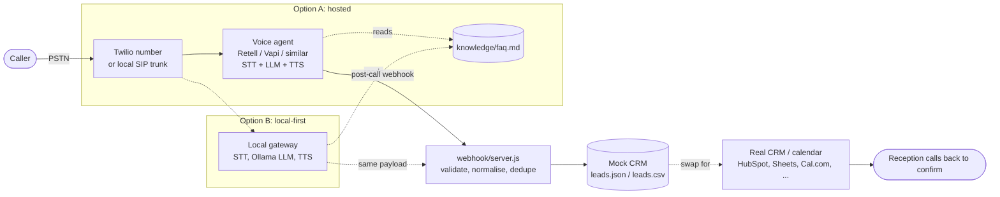

# Voice receptionist: AI phone receptionist for a small office or clinic in Jordan

An AI agent answers the business phone in Arabic and English. It answers FAQs from a knowledge file, takes booking or callback requests, and hands a clean lead to a CRM through a webhook. The business, caller, and numbers in this folder are fictional. No keys are included.

**What is runnable here:** the webhook receiver (mock CRM) and its test. The phone number and the voice agent are configured on the provider side using the prompt and knowledge file below.

## Files

| File | What it is |
|---|---|
| [system-prompt.md](system-prompt.md) | RCTC system prompt for the voice agent, with the structured output contract |
| [knowledge/faq.md](knowledge/faq.md) | Sample knowledge file (hours, services, starting prices, policies) |
| [webhook/server.js](webhook/server.js) | Zero-dependency Node webhook: validates the post-call payload and writes a lead to `data/leads.json` + `data/leads.csv` |
| [samples/transcript.md](samples/transcript.md) | Sample Arabic call, with what the agent did not do on purpose |
| [samples/call-ended.payload.json](samples/call-ended.payload.json) | The post-call payload for that call |
| [samples/expected-lead.json](samples/expected-lead.json) | The lead the webhook must write |
| [test/webhook.test.js](test/webhook.test.js) | Feeds the sample to the webhook and checks the lead (`npm run test:voice-receptionist`) |

## 60-second run path

From the repo root (Node 18 or newer, no install needed):

```bash
npm run test:voice-receptionist          # 9 checks, writes only to a temp dir
node examples/voice-receptionist/webhook/server.js
```

In a second terminal:

```bash
curl -s -X POST http://localhost:8787/webhook/call-ended \
  -H "content-type: application/json" \
  --data @examples/voice-receptionist/samples/call-ended.payload.json
# {"ok":true,"created":true,"lead_id":"lead_call_demo_0001"}
```

The lead is now in `examples/voice-receptionist/webhook/data/leads.csv` (git-ignored). Send the same request again: you get `200` with `"created":false`. Providers retry webhooks, so the CRM must not duplicate.

Optional: set `WEBHOOK_SECRET=...` and the server requires `x-signature: sha256=<HMAC of raw body>`. Use the signing scheme your provider documents, and adapt `signatureOk()` to it.

## Architecture



**Option A, hosted (fastest to launch).** A Twilio number forwards to a hosted voice agent such as Retell. Paste [system-prompt.md](system-prompt.md) and [knowledge/faq.md](knowledge/faq.md). Point the provider's post-call webhook at your deployed `server.js`. Map the provider's fields to the payload shape in `samples/call-ended.payload.json` in a few lines; providers name fields differently.

**Option B, local-first (data stays on your machine).** The same number or a SIP trunk reaches a local gateway that runs speech-to-text, an Ollama model, and text-to-speech, and posts the same payload to the same webhook. This trades latency and voice quality for privacy and near-zero per-minute model cost. Test Jordanian Arabic speech recognition on real calls before you promise it to a client.

In both options the webhook and CRM side does not change. That is the point of the contract.

## The RCTC prompt, in short

The full prompt is in [system-prompt.md](system-prompt.md).

- **Role:** phone receptionist for one named business; says it is automated.
- **Context:** Jordanian Arabic first, English when the caller switches; facts only from the knowledge file; Asia/Amman time; staff confirm bookings.
- **Task:** greet, find intent, answer the FAQ, collect name, phone, service, and time one question at a time, ask consent, read back, close.
- **Constraints:** no invented prices, slots, or names; no medical advice; emergencies go to 911; never "confirmed" without a calendar tool; no IDs or card numbers; short turns.
- **Proof:** a fixed JSON `extracted` block. The webhook returns `201` or `200`, or `422` with the reason. The test proves the sample call produces exactly [expected-lead.json](samples/expected-lead.json).

## Before you go live (checklist)

- Replace every `{{...}}` and all fictional data in `knowledge/faq.md`.
- Tell callers they are talking to an automated assistant and that the call may be recorded, as your provider and Jordanian law require.
- Turn on signature verification (`WEBHOOK_SECRET`), use HTTPS, and keep provider keys in environment variables, never in the repo.
- Swap `writeLead()` for your CRM or calendar API, and keep the idempotency check on `lead_id`.
- Listen to the first 20 real calls. Add every question the agent could not answer to the knowledge file.

---

## بالعربي: موظف استقبال آلي للعيادات والمكاتب الصغيرة بالأردن

وكيل ذكاء اصطناعي بيرد على تلفون العيادة أو المكتب بالعربي والإنجليزي. بيجاوب الأسئلة المتكررة من ملف معلومات، وبياخذ طلبات الحجز أو معاودة الاتصال، وبيبعت بيانات الزبون جاهزة لنظام إدارة العملاء (CRM) عن طريق webhook. كل الأسماء والأرقام هون وهمية، وما في ولا مفتاح سري.

**شو بيشتغل من هالمجلد:** مستقبل الـ webhook، يعني CRM تجريبي، والاختبار تبعه. أما الرقم والوكيل الصوتي فبتجهزهم عند المزوّد باستخدام البرومبت وملف المعلومات.

**التشغيل بدقيقة:**
1. `npm run test:voice-receptionist` بيشغّل 9 فحوصات.
2. `node examples/voice-receptionist/webhook/server.js` بيشغّل السيرفر على المنفذ 8787.
3. ابعت ملف `samples/call-ended.payload.json` بأمر `curl` اللي فوق، وبتلاقي الزبون انضاف على `webhook/data/leads.csv`.

**المعمارية:**
- **الخيار الأول، استضافة جاهزة:** رقم Twilio، بعدين وكيل صوتي مثل Retell، بعدين webhook، بعدين CRM أو تقويم. هاد أسرع طريق للإطلاق.
- **الخيار الثاني، محلي أولاً:** نفس الرقم بيوصل لبوابة محلية فيها تحويل الكلام لنص، ونموذج على Ollama، وتحويل النص لكلام. البيانات بتضل عندك وتكلفة الدقيقة شبه صفر، بس جرّب فهم اللهجة الأردنية على مكالمات حقيقية قبل ما تعد فيها زبون.

**قواعد الوكيل (RCTC):**
- **الدور:** موظف استقبال لعيادة أو مكتب واحد، وبيحكي من أول جملة إنه مساعد آلي.
- **السياق:** اللهجة الأردنية أولاً، وما بيحكي أي معلومة مش موجودة بملف المعلومات.
- **المهمة:** يسلّم، ويعرف شو بدّه المتصل، ويجاوب، وبعدين ياخذ الاسم والرقم والخدمة والوقت، سؤال ورا سؤال، ويطلب الموافقة على التواصل، ويعيد الملخص.
- **القيود:** ممنوع يخترع سعر أو موعد، وممنوع يعطي نصيحة طبية، وبالطوارئ بيحوّل على 911، وما بيقول "الموعد مؤكد" إلا إذا التقويم أكّد.
- **الإثبات:** بيطلع JSON ثابت، والـ webhook بيرجع 201 أو 200، أو 422 مع السبب.

**قبل الإطلاق:** بدّل المعلومات الوهمية، وبلّغ المتصل إنه بيحكي مع مساعد آلي، وفعّل التوقيع وHTTPS، واسمع أول 20 مكالمة حقيقية وكمّل ملف المعلومات منها.

---

Want this built and running on your own business number (Arabic or English, hosted or local-first)? That is a paid service: [suhib-ai-delivery-portfolio.vercel.app](https://suhib-ai-delivery-portfolio.vercel.app/) · بدك ياه شغّال على رقم شركتك؟ هاي خدمة مدفوعة: [suhib-ai-delivery-portfolio.vercel.app](https://suhib-ai-delivery-portfolio.vercel.app/)
